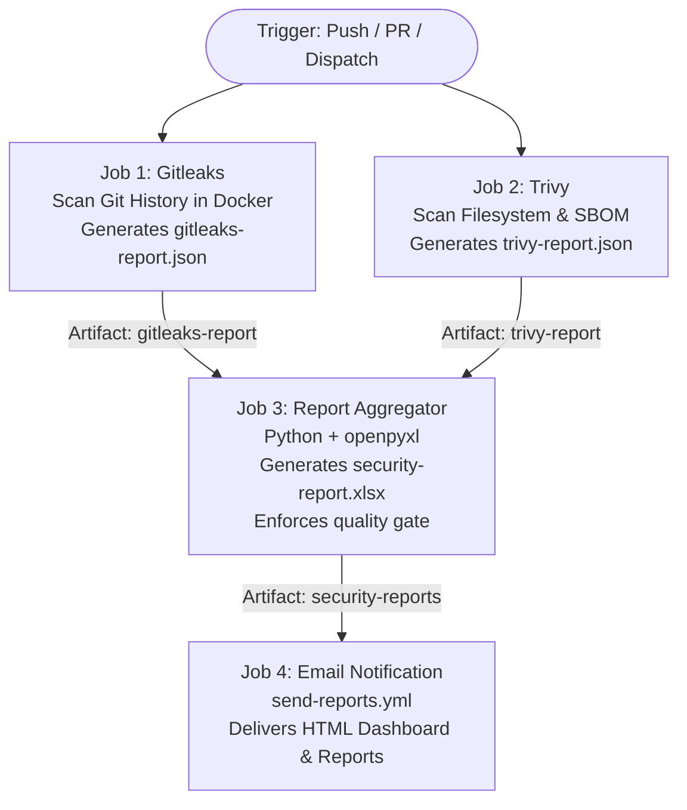

# DevSecOps Platform Architecture

## 1. Purpose

The DevSecOps Platform provides a centralized system for managing reusable CI/CD workflows, security checks, code quality validation, and release automation across multiple projects and repositories.

The platform uses GitHub Actions as its primary workflow orchestration engine and GitHub-hosted runners as the default execution environment.

The architecture minimizes infrastructure management and provides a standardized approach to SDLC automation.

## 2. Architectural Principles

- Centralize reusable workflow definitions.
- Keep application repositories independent.
- Avoid dedicated, always-running CI/CD servers.
- Prefer free and open-source tools.
- Use least-privilege permissions.
- Version and review shared workflows.
- Introduce security gates incrementally.
- Support multiple programming languages and project types.
- Keep onboarding simple and repeatable.

## 3. High-Level Architecture

```text
                  DevSecOps Platform
                 Central Repository
                         |
             Reusable GitHub Workflows
                         |
          +--------------+--------------+
          |              |              |
      Project A      Project B      Project C
      Repository     Repository     Repository
          |              |              |
          +--------------+--------------+
                         |
                 GitHub Actions
                         |
                GitHub-Hosted Runners
                         |
          +--------------+--------------+
          |              |              |
       Secret         Dependency       SAST
       Scanning       Scanning         Checks
          |              |              |
          +--------------+--------------+
                         |
                Security Gate Results
                         |
               Pull Request Validation
                         |
                 Approved Merge
```

## 4. Main Components

### 4.1 Central Platform Repository

Repository name: `Action-Engine`

Responsibilities:

- Maintain central and client scanning workflows.
- Provide the reusable notification and dashboard workflow (`send-reports.yml`).
- Define common security policies.
- Maintain workflow documentation.
- Manage workflow versions.
- Provide repository onboarding instructions.
- Maintain shared scripts (such as `scripts/generate_security_report.py`).

This repository is the central source of truth for shared DevSecOps automation.

### 4.2 Pipeline Execution Architecture

Each scanning workflow follows a 4-stage job pipeline:



1. **Parallel Scanners (`gitleaks`, `trivy`)**: Execute concurrently on separate runners to reduce overall pipeline execution time.
2. **Aggregator (`report`)**: Downloads both scanner outputs, compiles a unified multi-sheet Excel dashboard, sets `$GITHUB_OUTPUT` metrics, uploads the bundled `security-reports` artifact, and acts as the quality gate.
3. **Notifier (`email`)**: Executes `if: always()` after the aggregator to deliver styled HTML dashboards and attachments to designated stakeholders.

### 4.2 Application Repositories

Each application repository contains its application source code and a small caller workflow.

Responsibilities:

- Maintain application code and tests.
- Invoke approved reusable workflows.
- Supply project-specific parameters when necessary.
- Fix security and quality findings.
- Enforce required checks through repository rulesets.

Application repositories should not need to duplicate the complete implementation of every shared security pipeline.

### 4.3 GitHub Actions

GitHub Actions coordinates workflow execution.

It supports:

- Push-triggered workflows.
- Pull request validation.
- Scheduled scans.
- Manual execution.
- Reusable workflows.
- Job dependencies and conditional execution.

### 4.4 GitHub-Hosted Runners

GitHub-hosted runners provide temporary execution environments for workflow jobs.

Benefits:

- No runner server to install or maintain.
- No permanent Jenkins instance required.
- Standard Linux environments for common build and security tasks.
- Independent job execution with fresh environments.

Usage remains subject to GitHub Actions quotas, availability, and applicable plan limits.

### 4.5 Security Tools

| Tool | Purpose |
|---|---|
| Gitleaks | Detect exposed secrets |
| Trivy | Scan dependencies, container images, and IaC |
| Semgrep | Static application security analysis |
| Dependency Review | Inspect dependency changes in pull requests |
| Syft | Generate Software Bills of Materials |

These tools are planned capabilities. Each will be integrated and validated before becoming an enforced check.

## 5. Workflow Execution Model

### Step 1: Developer Opens a Pull Request

A developer pushes a branch and creates a pull request against the target repository.

### Step 2: Caller Workflow Starts

The application's GitHub Actions workflow invokes the relevant reusable workflow from `Action-Engine`.

### Step 3: Runner Is Provisioned

GitHub Actions schedules the job on a GitHub-hosted runner.

### Step 4: Checks Execute

The workflow performs the configured scans and validation tasks.

### Step 5: Results Are Reported

Each workflow returns a pass or fail status to the pull request.

Sensitive findings must not be exposed through unrestricted logs or artifacts.

### Step 6: Merge Rules Are Applied

Repository rulesets can require selected checks to pass before merging.

A failed required security check blocks the merge.

## 6. Reusable Workflow Design

Reusable workflows should use the GitHub Actions `workflow_call` trigger.

Example caller:

```yaml
name: Security Checks

on:
  pull_request:

permissions:
  contents: read

jobs:
  secret-scan:
    uses: ORGANIZATION/Action-Engine/.github/workflows/secret-scan-reusable.yml@VERSION
```

Replace `ORGANIZATION` and `VERSION` with the actual owner and a reviewed release tag or full commit SHA.

For production, prefer immutable full commit SHAs for reusable workflows and third-party actions.

## 7. Security Boundaries

The architecture must distinguish between trusted platform maintenance and untrusted application pull request content.

Required controls:

- Use read-only permissions unless additional access is necessary.
- Do not expose production secrets to pull request jobs.
- Avoid privileged triggers that execute untrusted pull request code.
- Disable persisted checkout credentials when Git operations do not require them.
- Pin external actions to reviewed commit SHAs.
- Set job timeouts.
- Review changes to shared workflows before releasing them.

## 8. Workflow Version Management

Shared workflows affect multiple repositories, so version management is essential.

Recommended approach:

1. Develop workflow changes on a feature branch.
2. Test against a pilot repository.
3. Review security and compatibility implications.
4. Publish a versioned release.
5. Update application repositories through reviewed changes.
6. Retain the previous known-good version for rollback.

Avoid automatically switching every production repository to an unreviewed workflow change.

## 9. Configuration Strategy

Use the simplest configuration mechanism that satisfies the requirement.

- Workflow inputs: parameters for reusable workflows.
- Repository variables: non-sensitive settings.
- GitHub Actions secrets: credentials that are genuinely required.
- Version-controlled configuration files: shared policies and scanner settings.

Secret scanning itself should not require application deployment credentials.

## 10. Cost and Infrastructure

The default architecture avoids dedicated CI/CD servers.

| Component | Dedicated server required? |
|---|---|
| GitHub Actions orchestration | No |
| GitHub-hosted runners | No |
| Gitleaks scanning | No |
| Trivy scanning | No |
| Semgrep CLI scanning | No |
| Reporting through workflow checks | No |

Free usage is not unlimited. Private-repository workflows consume applicable GitHub Actions allowances, and some advanced GitHub security features may require a paid plan.

## 11. Future Extensions

The architecture can later support:

- Standardized build and test workflows.
- Container image publishing.
- SBOM generation and artifact signing.
- Deployment verification.
- Environment approvals.
- Short-lived cloud credentials through OIDC.
- Security coverage reporting across repositories.
- Scheduled vulnerability checks.

Each extension should be introduced only when its security benefits, maintenance cost, and operational requirements are understood.

## 12. Conclusion

The DevSecOps Platform uses centralized, reusable GitHub Actions workflows to standardize SDLC automation across multiple repositories.

The initial implementation focuses on secret scanning, with additional security and delivery capabilities introduced incrementally.

The design prioritizes low infrastructure overhead, consistent security enforcement, maintainability, and production safety.